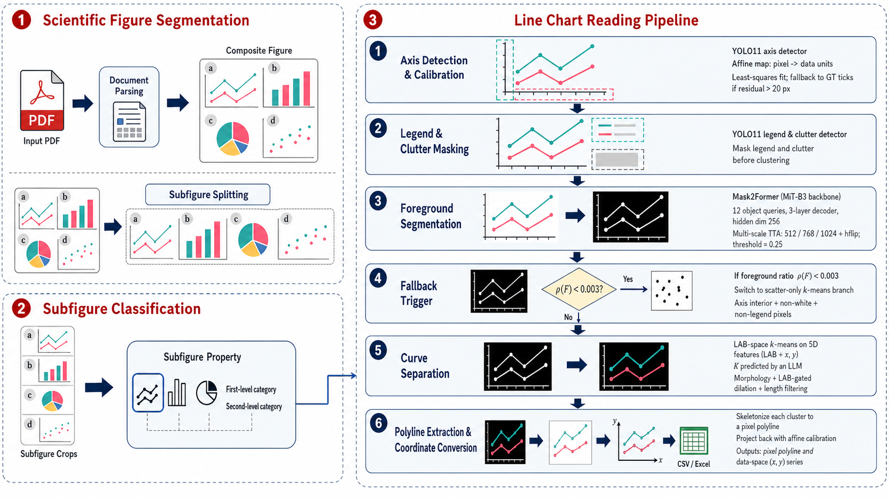

# MatCurvs: Article Real-Coordinate Curve Extraction for Agent-Ready Materials Reasoning

> NeurIPS 2026 (Datasets and Benchmarks track) — code for the **MatDeplot** extraction method
> and reproduction scripts for the **MatCurvs** benchmark and **MatCurvs-Reasoning** evaluation.

## Authors
- **Liang Yin** · School of Advanced Interdisciplinary Sciences,
  University of Chinese Academy of Sciences · `yinliang22@mails.ucas.ac.cn`
- **Songlin Yu** (corresponding) · University of Chinese Academy of Sciences ·
  `yusonglin22@mails.ucas.ac.cn`
- **Jianjun Liu** (corresponding) · Shanghai Institute of Ceramics,
  Chinese Academy of Sciences · `jliu@mail.sic.ac.cn`

## Datasets — on HuggingFace

The benchmark itself lives at **https://huggingface.co/datasets/yinliang22/matcurvs**
in three subsets:

| Subset | Content | Use |
|---|---|---|
| `matcurvs_l0/` | $\sim 1.4{\,}M$ classified subfigures (chart-type + 3×10 taxonomy) over $55{,}763$ articles | Subfigure routing |
| `matcurvs_l1/` | $204$ panels with manual per-curve pixel polylines ($n{=}90$ leakage-clean hold) | Pixel-anchor evaluation (LR$_θ$) |
| `matcurvs_l2/` | $8{,}026$ verified real-coordinate curves over $3{,}817$ panels | Agentic numerical-reasoning evaluation |

Download:
```bash
pip install huggingface_hub
huggingface-cli download yinliang22/matcurvs --repo-type dataset --local-dir ./matcurvs
```

## Pipeline



The MatDeplot extractor takes a published materials-science chart image and produces
per-curve real-coordinate $(x, y)$ data with explicit confidence and abstain channels.

## Headline numbers (NeurIPS 2026 D&B paper)

| Failure mode | Best hosted VLM | MatDeplot | Gap |
|---|---|---|---|
| Pixel anchoring (LR$_{0.5}$ on $n{=}90$ leakage-clean L1) | $\le 1.2\%$ | $45.8\%$ | **$38\times$** |
| Agentic numerical reasoning, image only (`y` at $x_0$, $14{,}740$ Q) | $99.8\%$ rel-err | — | — |
| Same task, image-blind LLM with extracted $(x,y)$ | — | $1.5\%$ | **$67\times$** |
| EIS Z′ intercept, image only | $100\%$ rel-err | — | — |
| Same task, with $(x,y)$ data | — | $0\%$ | **∞** |
| Stacked-spectra intensity offset, image only | $99\%$ rel-err | — | — |
| Same task, with $(x,y)$ data | — | $3\%$ | **$33\times$** |

## Repository structure

```
matcurvs/
├── pipeline.py                 # MatDeplot end-to-end driver
├── mask2former_line.py         # Cell 3: foreground segmenter
├── Axis_yolo_extraction.py     # Cell 1+2: axis & legend
├── ModalLLMResponse.py         # Multimodal-LLM API wrappers
├── classifier/                 # Subfigure-classifier training code
├── experiments/                # Benchmark builders, runners, scorers
└── assets/                     # Pipeline overview figure
```

## Setup

```bash
git clone https://github.com/yinliang420/matcurvs.git
cd matcurvs
python -m venv .venv && source .venv/bin/activate
pip install -r requirements.txt
cp .env.example .env  # then fill in DASHSCOPE_API_KEY / OPENAI_API_KEY / GOOGLE_API_KEY etc.
```

## Reproducing the benchmark

1. Download the three subsets from HuggingFace into `./matcurvs/`.
2. Run the MatCurvs-Reasoning pipeline:
   ```bash
   python experiments/mr_task_builder.py        # builds the 14,740-question benchmark
   python experiments/mr_runner.py --set rigorous --method m1 --model qwen-vl-max --workers 8
   python experiments/mr_runner.py --set rigorous --method m3 --model qwen3-max --workers 8
   python experiments/mr_scipy_oracle.py --set rigorous
   python experiments/mr_scorer.py --set rigorous
   ```
3. See `experiments/MR_BENCHMARK_README.md` for the four-method (M1/M2/M3/M4) protocol.

## Citation

(BibTeX placeholder; final entry to be added on acceptance.)

## License

Code: MIT. Benchmark: CC-BY-4.0 (see HuggingFace dataset card).
